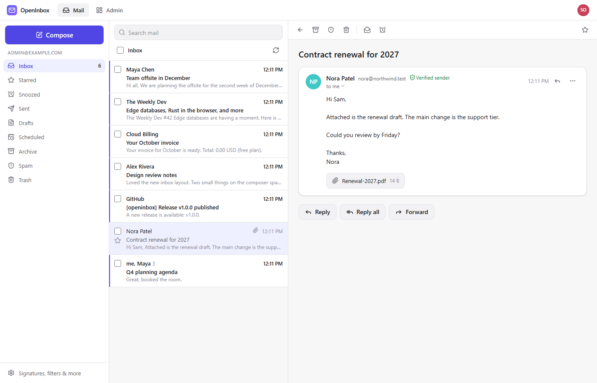

<div align="center">


# OpenInbox

**Your own email on your own domains, running entirely in your free Cloudflare account.**

[](https://deploy.workers.cloudflare.com/?url=https://github.com/sums001/OpenInbox)

</div>



## Features

- **Receive** on any domain in your Cloudflare account. Email Routing is set up for you.
- **Send** through Resend, Brevo, Mailjet or any SMTP server. DNS records are written for you, and when one provider hits its free limit, mail falls back to another.
- **A full web inbox:** threads, search (`from:` `has:attachment` `before:`), labels, filters, snooze, scheduled and undo send, dark mode, mobile layout.
- **Teams:** multiple users, personal and shared inboxes, aliases, `you+tag@` addressing, catch-all.
- **An admin dashboard** showing traffic, free-tier usage, domain health with one-click repair, and delivery and audit logs.
- **Safe by default:** HTML mail is sanitized and sandboxed, remote images are blocked until you allow them, failed SPF/DKIM/DMARC goes to Spam, two-factor sign-in is optional, and stored credentials are encrypted.

## Deploy

You need a free Cloudflare account, a GitHub account, and a domain on Cloudflare's nameservers. Sending needs a free account with a provider, but receiving works without one.

**1. Click Deploy to Cloudflare**, then **Deploy**. The form asks for nothing else; keep the default names or change them.

**2. Open the Worker's `workers.dev` address.** The setup page asks for a Cloudflare API token, which OpenInbox uses to set up Email Routing and DNS for you. Click **Create token**: Cloudflare opens with every permission filled in, so you only click **Continue to summary → Create Token** and paste the token back. It is stored encrypted. If the Worker shows no `workers.dev` URL, turn it on in the Worker's **Settings → Domains & Routes**.

Connecting the token creates your **recovery key** and shows it once. **Save it in a password manager.** You paste it to finish setup, and it is the only way back into the owner account if you lose your password.

**3. Follow the setup page.** It checks the token's permissions, creates your admin account and connects your domain.

<details>
<summary>The token's permissions (filled in for you by <a href="https://dash.cloudflare.com/profile/api-tokens?permissionGroupKeys=%5B%7B%22key%22%3A%22zone%22%2C%22type%22%3A%22read%22%7D%2C%7B%22key%22%3A%22dns%22%2C%22type%22%3A%22edit%22%7D%2C%7B%22key%22%3A%22email_routing_rules%22%2C%22type%22%3A%22edit%22%7D%2C%7B%22key%22%3A%22workers_routes%22%2C%22type%22%3A%22edit%22%7D%2C%7B%22key%22%3A%22analytics%22%2C%22type%22%3A%22read%22%7D%2C%7B%22key%22%3A%22workers_scripts%22%2C%22type%22%3A%22edit%22%7D%2C%7B%22key%22%3A%22email_routing_addresses%22%2C%22type%22%3A%22edit%22%7D%2C%7B%22key%22%3A%22account_analytics%22%2C%22type%22%3A%22read%22%7D%2C%7B%22key%22%3A%22account_settings%22%2C%22type%22%3A%22read%22%7D%2C%7B%22key%22%3A%22workers_r2%22%2C%22type%22%3A%22edit%22%7D%5D&accountId=*&zoneId=all&name=OpenInbox">this link</a>)</summary>

| Scope | Permission | Access | |
| --- | --- | --- | --- |
| Zone | Zone | Read | required |
| Zone | DNS | Edit | required |
| Zone | Email Routing Rules | Edit | required |
| Account | Workers Scripts | Edit | required |
| Account | Account Settings | Read | recommended |
| Zone | Workers Routes | Edit | optional: app on `mail.yourdomain` |
| Zone | Analytics | Read | optional: delivery log |
| Account | Email Routing Addresses | Edit | optional: forwarding |
| Account | Account Analytics | Read | optional: usage on the dashboard |
| Account | Workers R2 Storage | Edit | optional: attachments bucket |

</details>

**4. Connect a sending provider** in Admin → Integrations.

## Free-tier limits

| What | Free limit |
| --- | --- |
| Worker requests | 100,000 / day per account |
| D1 storage | 500 MB, roughly 50,000–100,000 messages |
| Incoming message size | 25 MB |
| Sending | Resend 100/day, Brevo 300/day, Mailjet 200/day |

Mail is stored text-only by default. Attachments are kept only on messages under 950 KB. To keep every attachment, turn on R2 storage in Admin → Integrations → Attachments. R2 has a 10 GB free tier, but Cloudflare requires a payment method on the account first.

## Updating

In your copy of the repo on GitHub, run **Actions → Sync upstream → Run workflow**. It also runs weekly by itself. Cloudflare redeploys automatically, and the Worker applies any database migrations itself. Don't click the Deploy button again to update: it makes a second, separate instance.

## Troubleshooting

- **Mail not arriving or not sending:** start with Admin → Domains → *Check health* and Admin → Mail flow.
- **Locked out of the owner account:** on the sign-in page, choose *Owner locked out?* and enter the owner email and your recovery key.
- **"A repository with that name already exists" on the Deploy form:** an earlier deploy already made a repo with that name. Change **Project name** in the form, or update the existing instance instead (see Updating).

## Development

```sh
npm ci
# create .dev.vars with the lines below
npm run db:migrate:local
npm run dev:mock                 # terminal 1: mock Cloudflare and provider APIs on :8790
npm run dev                      # terminal 2: app on http://localhost:5173
```

Local `.dev.vars` (never put real credentials here):

```sh
ENCRYPTION_KEY=any-long-random-string-for-local-use
CF_API_TOKEN=dev-token
CF_API_BASE=http://127.0.0.1:8790/cf
RESEND_API_BASE=http://127.0.0.1:8790/resend
BREVO_API_BASE=http://127.0.0.1:8790/brevo
MAILJET_API_BASE=http://127.0.0.1:8790/mailjet
GITHUB_API_BASE=http://127.0.0.1:8790/github
WORKER_NAME=openinbox
```

Before opening a pull request, run `npm run lint && npm run typecheck && npm test && npm run test:e2e`.

Report security issues privately through GitHub's **Security → Report a vulnerability**, not in a public issue.

## License

[MIT](LICENSE)
