<div align="center">

<picture>
  <source media="(prefers-color-scheme: dark)" srcset="assets/logos/openinbox-lockup-dark.png">
  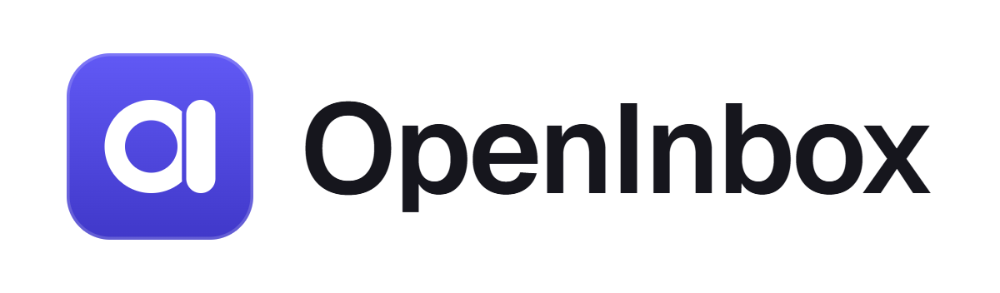
</picture>

### Free, unlimited business email on your own domains

Unlimited users, mailboxes, aliases and domains, hosted entirely in your own free Cloudflare account.<br>
No per-seat fees, no servers to run, no vendor holding your mail.

[](https://deploy.workers.cloudflare.com/?url=https://github.com/sums001/OpenInbox)

[](LICENSE)


[](#contributing)

[Features](#features) · [Screenshots](#screenshots) · [Deploy](#deploy) · [Roadmap](#roadmap) · [Contributing](#contributing)

</div>

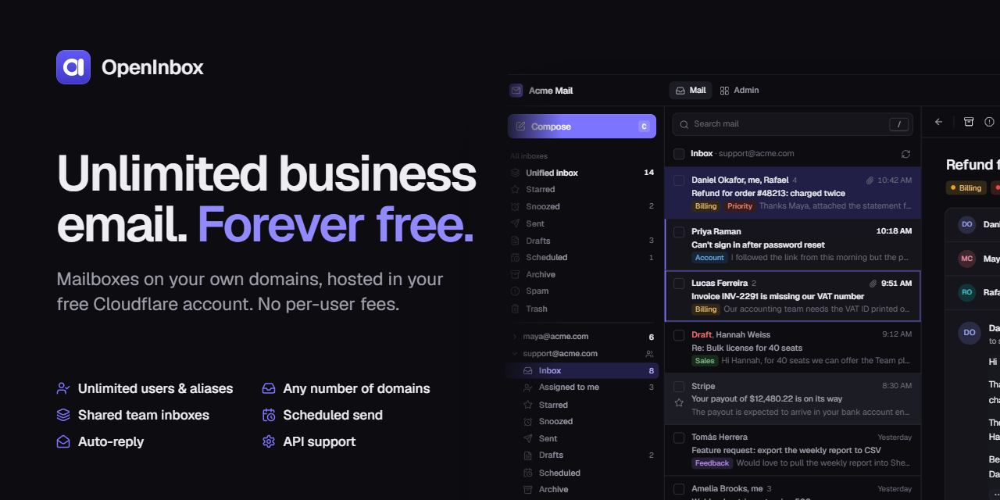

> [!WARNING]
> **OpenInbox is in beta.** It may have bugs and needs extensive testing. Try it on a spare domain before you rely on it for important mail. See [Project status](#project-status).

## Contents

- [Why OpenInbox](#why-openinbox)
- [Who it's for](#who-its-for)
- [Features](#features)
- [Screenshots](#screenshots)
- [How it works](#how-it-works)
- [Deploy](#deploy)
- [Free-tier limits](#free-tier-limits)
- [Use it responsibly](#use-it-responsibly)
- [Updating](#updating)
- [Troubleshooting](#troubleshooting)
- [Roadmap](#roadmap)
- [Project status](#project-status)
- [Contributing](#contributing)
- [License](#license)

## Why OpenInbox

Business email usually costs a few dollars per user per month, every month. OpenInbox gives you the same thing for free: one Cloudflare Worker and one D1 database, deployed into **your** Cloudflare account with a single click. You own the data and the domains, and adding the tenth or the hundredth user costs nothing.

| | Typical hosted email | OpenInbox |
| --- | --- | --- |
| **Price** | Per user, per month | Free on Cloudflare's free plan |
| **Users and mailboxes** | Paid seats | Unlimited |
| **Domains and aliases** | Often capped | Unlimited |
| **Where your mail lives** | The vendor's servers | Your own Cloudflare account |
| **Source code** | Closed | Open source (MIT) |

## Who it's for

| Who | What OpenInbox gives them |
| --- | --- |
| **Solo and indie developers** | `you@yourproduct.com` for every side project, without paying for each one |
| **Small businesses and startups** | Shared `support@`, `sales@` and `billing@` for a growing team, with no per-seat bill |
| **Freelancers, agencies and consultants** | Mail for several brands or client domains, managed from one place |
| **Open-source projects, nonprofits and communities** | Role addresses and shared inboxes on a zero budget |
| **Families and personal domains** | A mailbox for everyone on `yourname.com` |
| **Privacy-minded people and self-hosters** | Mail in your own account, running code you can read |

OpenInbox is built for everyday conversations. It is not a bulk or marketing sender (see [Use it responsibly](#use-it-responsibly)).

## Features

**Mail**
- Receive on any domain in your Cloudflare account. Email Routing is set up for you.
- Send through Resend, Brevo, Mailjet or any SMTP server. When one provider hits its free limit, mail falls back to another.
- Threads, All Mail, search (`from:` `has:attachment` `before:`), labels, filters, snooze, scheduled and undo send.
- Command palette and keyboard shortcuts, dark mode, mobile layout.

**Teams**
- Unlimited users, with personal and shared inboxes.
- Aliases, `you+tag@` addressing and catch-all.

**Admin**
- Dashboard with traffic, free-tier usage and delivery and audit logs.
- Domain health checks with one-click repair. DNS records (SPF, DKIM, DMARC) are written for you.

**Security**
- HTML mail is sanitized and sandboxed, and remote images are blocked until you allow them.
- Mail that fails SPF, DKIM or DMARC goes to Spam.
- Optional two-factor sign-in. Stored credentials are encrypted.

## Screenshots

<sub>Click any screenshot to open it full size.</sub>

**Mail**

<table>
  <tr>
    <td width="25%" align="center"><a href="assets/screens/mail-light.png">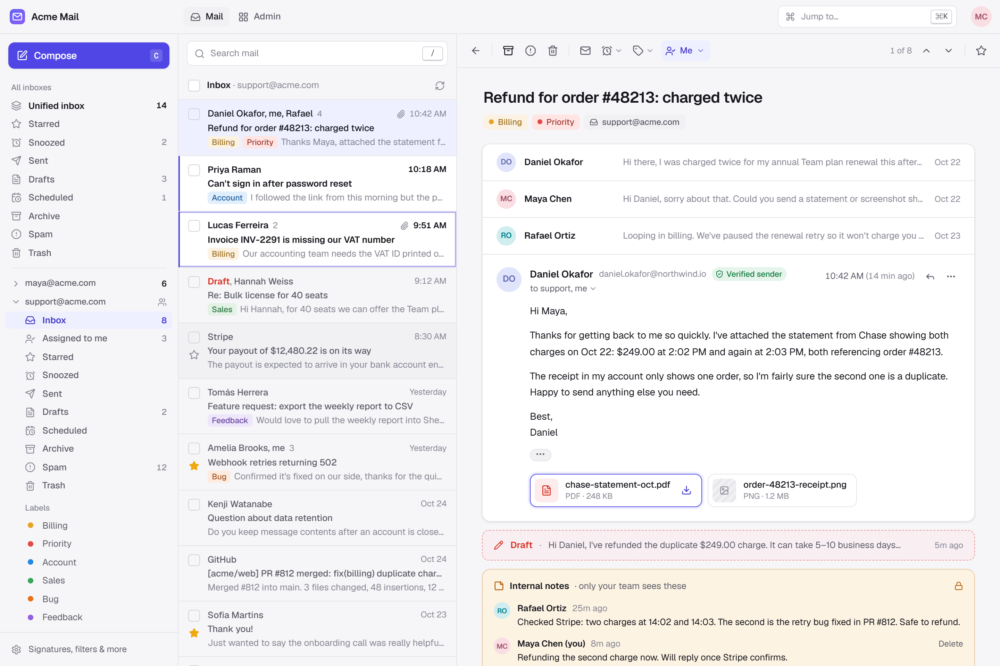</a><br><sub>Inbox, light</sub></td>
    <td width="25%" align="center"><a href="assets/screens/mail-dark.png">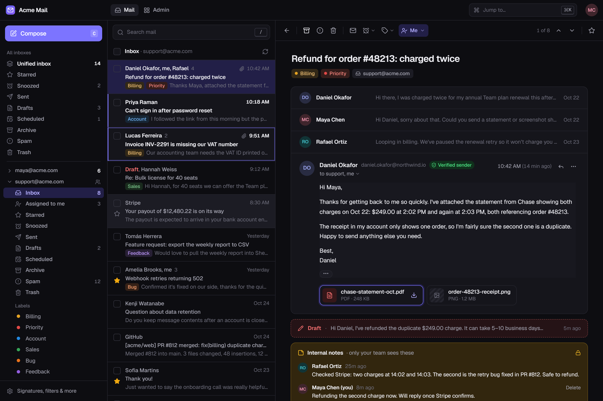</a><br><sub>Inbox, dark</sub></td>
    <td width="25%" align="center"><a href="assets/screens/mail-composer.png">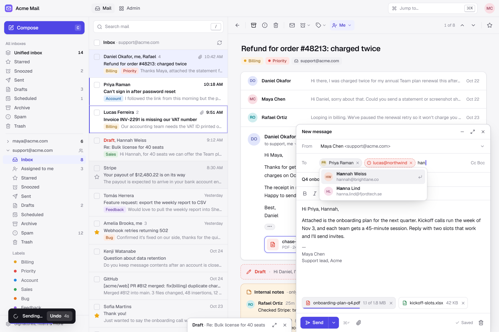</a><br><sub>Composer</sub></td>
    <td width="25%" align="center"><a href="assets/screens/mail-command-palette.png">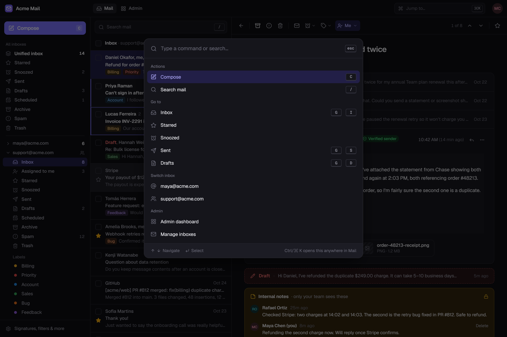</a><br><sub>Command palette</sub></td>
  </tr>
</table>

**Admin**

<table>
  <tr>
    <td width="33%" align="center"><a href="assets/screens/admin-overview-light.png">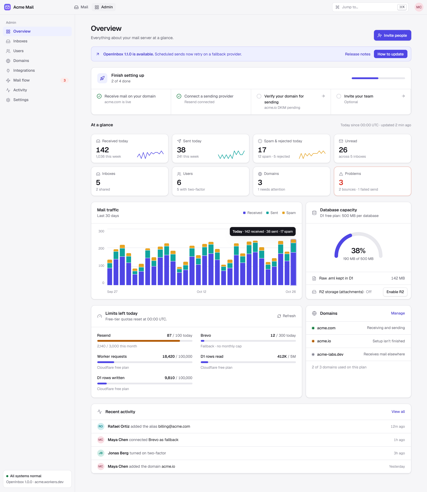</a><br><sub>Overview, light</sub></td>
    <td width="33%" align="center"><a href="assets/screens/admin-overview-dark.png">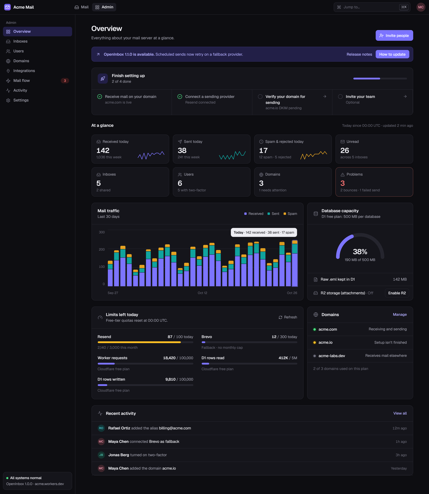</a><br><sub>Overview, dark</sub></td>
    <td width="33%" align="center"><a href="assets/screens/admin-mail-flow-dark.png">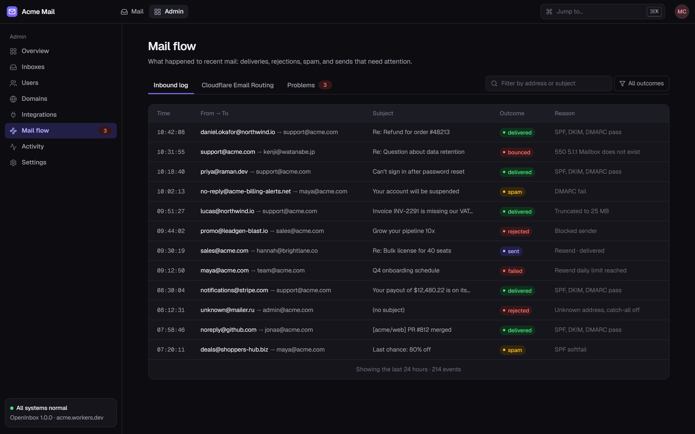</a><br><sub>Mail flow</sub></td>
  </tr>
  <tr>
    <td width="33%" align="center"><a href="assets/screens/admin-users.png">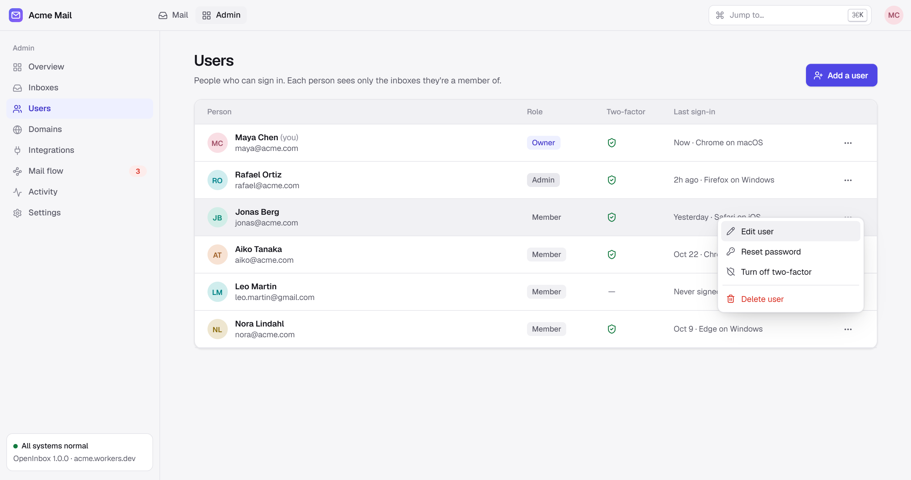</a><br><sub>Users</sub></td>
    <td width="33%" align="center"><a href="assets/screens/admin-domains.png">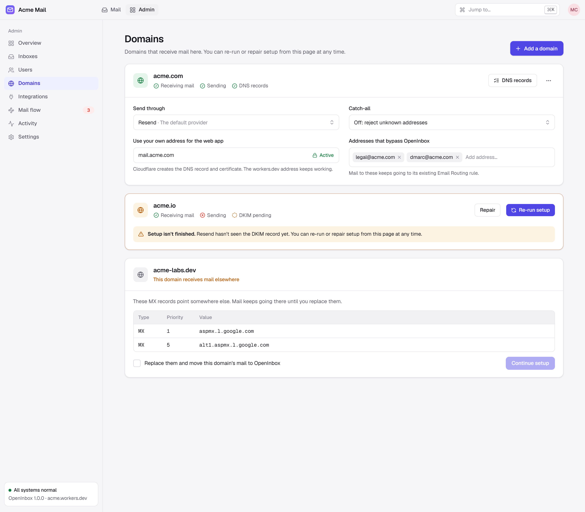</a><br><sub>Domains</sub></td>
    <td width="33%" align="center"><a href="assets/screens/admin-integrations.png">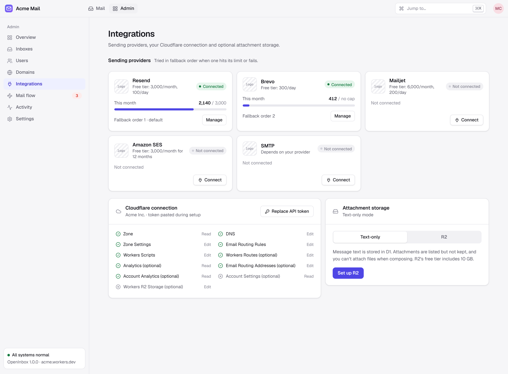</a><br><sub>Integrations</sub></td>
  </tr>
</table>

## How it works

Everything runs inside your own Cloudflare account. There is no OpenInbox server in between.

| Part | What it does |
| --- | --- |
| **Cloudflare Email Routing** | Receives mail for your domains and hands it to the Worker |
| **One Worker** | Runs the web app, the API, inbound mail handling and scheduled jobs |
| **One D1 database** | Stores mailboxes, messages, users and settings |
| **A sending provider** | Delivers outgoing mail (Resend, Brevo, Mailjet or SMTP), with fallback between them |
| **R2 (optional)** | Keeps large attachments |

## Deploy

### Requirements

- A free Cloudflare account, with a domain on Cloudflare's nameservers.
- A GitHub account.
- A free account with a sending provider. This is only needed to send; receiving works without one.

### Steps

**1. Click Deploy to Cloudflare**, then **Deploy**. The form asks for nothing else. Keep the default names or change them.

**2. Open the Worker's `workers.dev` address.** The setup page asks for a Cloudflare API token, which OpenInbox uses to set up Email Routing and DNS for you. Click **Create token**: Cloudflare opens with every permission filled in, so you only click **Continue to summary → Create Token** and paste the token back. It is stored encrypted.

> [!TIP]
> If the Worker shows no `workers.dev` URL, turn it on in the Worker's **Settings → Domains & Routes**.

> [!IMPORTANT]
> Connecting the token creates your **recovery key** and shows it **once**. Save it in a password manager. You paste it to finish setup, and it is the only way back into the owner account if you lose your password.

**3. Follow the setup page.** It checks the token's permissions, creates your admin account and connects your domain.

**4. Connect a sending provider** in **Admin → Integrations**.

#### Walkthrough

<sub>Each screenshot shows one step of a real deploy. Click one to open it full size.</sub>

<table>
  <tr>
    <td width="25%" align="center"><a href="assets/deployment/deploy-1-button.png">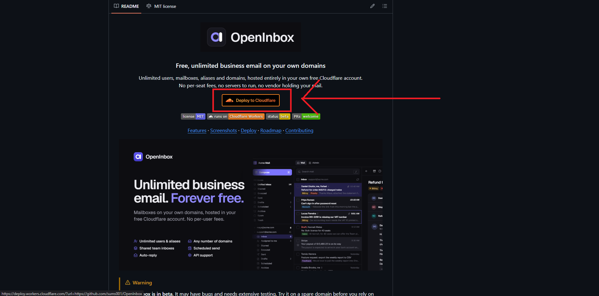</a><br><sub><b>1.</b> Click Deploy to Cloudflare</sub></td>
    <td width="25%" align="center"><a href="assets/deployment/deploy-2-form.png">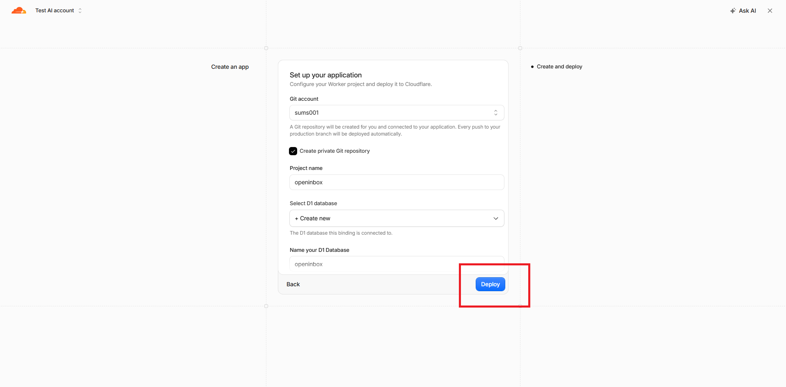</a><br><sub><b>2.</b> Keep the defaults, click Deploy</sub></td>
    <td width="25%" align="center"><a href="assets/deployment/deploy-3-token-permissions.png">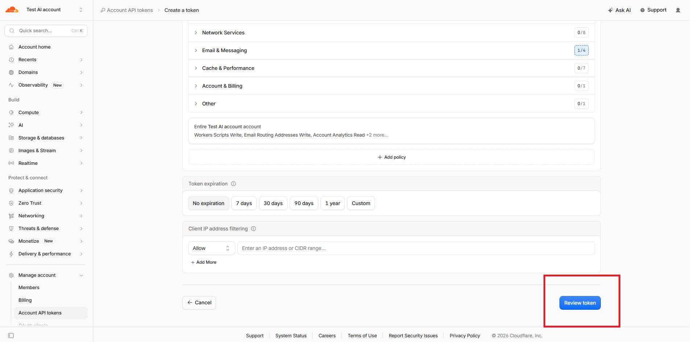</a><br><sub><b>3.</b> Create token: Review token</sub></td>
    <td width="25%" align="center"><a href="assets/deployment/deploy-4-token-review.png">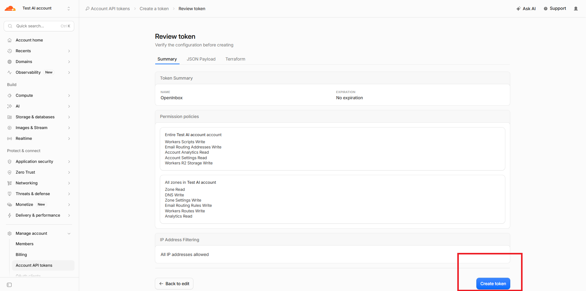</a><br><sub><b>4.</b> Create token</sub></td>
  </tr>
  <tr>
    <td width="25%" align="center"><a href="assets/deployment/deploy-5-token-created.png">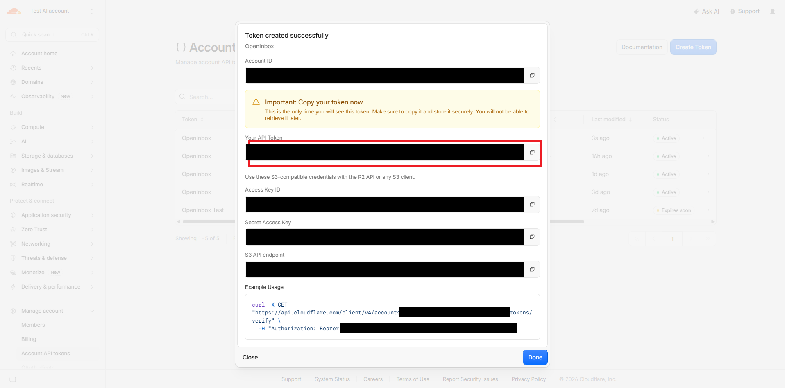</a><br><sub><b>5.</b> Copy the API token</sub></td>
    <td width="25%" align="center"><a href="assets/deployment/setup-1-connect.png">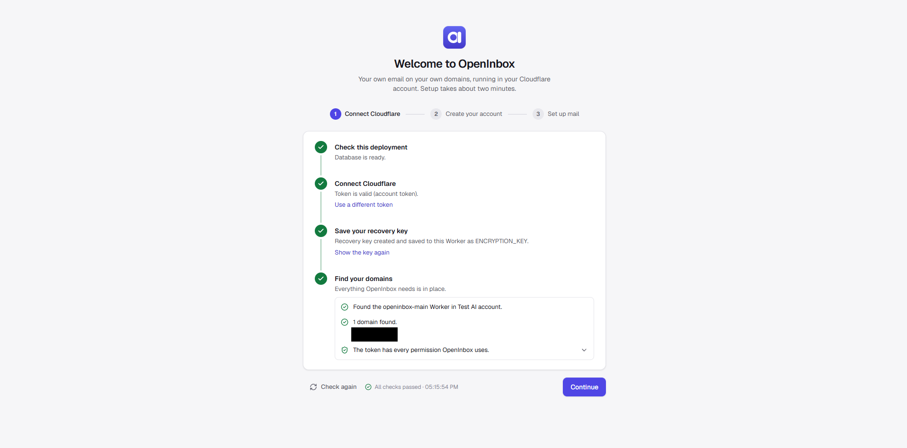</a><br><sub><b>6.</b> Paste it; checks pass</sub></td>
    <td width="25%" align="center"><a href="assets/deployment/setup-2-account.png">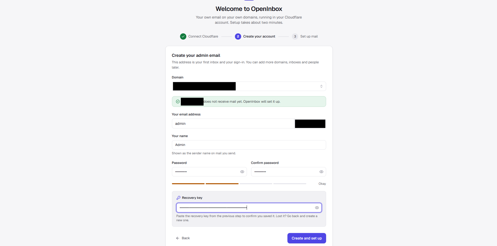</a><br><sub><b>7.</b> Create your admin email</sub></td>
    <td width="25%" align="center"><a href="assets/deployment/setup-3-done.png">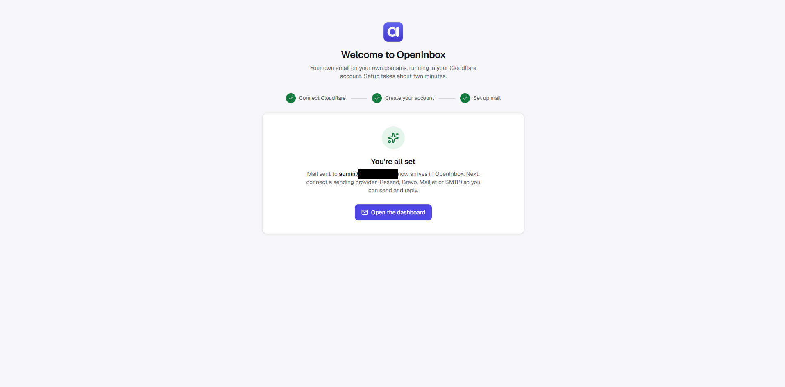</a><br><sub><b>8.</b> Done: mail arrives</sub></td>
  </tr>
</table>

<details>
<summary>The token's permissions (filled in for you by <a href="https://dash.cloudflare.com/?to=/:account/api-tokens&amp;permissionGroupKeys=%5B%7B%22key%22%3A%22c8fed203ed3043cba015a93ad1616f1f%22%2C%22type%22%3A%22read%22%7D%2C%7B%22key%22%3A%224755a26eedb94da69e1066d98aa820be%22%2C%22type%22%3A%22edit%22%7D%2C%7B%22key%22%3A%223030687196b94b638145a3953da2b699%22%2C%22type%22%3A%22edit%22%7D%2C%7B%22key%22%3A%2279b3ec0d10ce4148a8f8bdc0cc5f97f2%22%2C%22type%22%3A%22edit%22%7D%2C%7B%22key%22%3A%2228f4b596e7d643029c524985477ae49a%22%2C%22type%22%3A%22edit%22%7D%2C%7B%22key%22%3A%229c88f9c5bce24ce7af9a958ba9c504db%22%2C%22type%22%3A%22read%22%7D%2C%7B%22key%22%3A%22e086da7e2179491d91ee5f35b3ca210a%22%2C%22type%22%3A%22edit%22%7D%2C%7B%22key%22%3A%22e4589eb09e63436686cd64252a3aebeb%22%2C%22type%22%3A%22edit%22%7D%2C%7B%22key%22%3A%22b89a480218d04ceb98b4fe57ca29dc1f%22%2C%22type%22%3A%22read%22%7D%2C%7B%22key%22%3A%22c1fde68c7bcc44588cbb6ddbc16d6480%22%2C%22type%22%3A%22read%22%7D%2C%7B%22key%22%3A%22bf7481a1826f439697cb59a20b22293e%22%2C%22type%22%3A%22edit%22%7D%5D&amp;name=OpenInbox">this link</a>)</summary>

| Scope | Permission | Access | |
| --- | --- | --- | --- |
| Zone | Zone | Read | required |
| Zone | DNS | Edit | required |
| Zone | Zone Settings | Edit | required: turn on Email Routing |
| Zone | Email Routing Rules | Edit | required |
| Account | Workers Scripts | Edit | required |
| Account | Account Settings | Read | recommended |
| Zone | Workers Routes | Edit | optional: app on `mail.yourdomain` |
| Zone | Analytics | Read | optional: delivery log |
| Account | Email Routing Addresses | Edit | optional: forwarding |
| Account | Account Analytics | Read | optional: usage on the dashboard |
| Account | Workers R2 Storage | Edit | optional: attachments bucket |

</details>

## Free-tier limits

| What | Free limit |
| --- | --- |
| Worker requests | 100,000 / day per account |
| D1 storage | 500 MB, roughly 50,000–100,000 messages |
| Incoming message size | 25 MB |
| Sending | Resend 100/day, Brevo 300/day, Mailjet 200/day |

Mail is stored text-only by default, and attachments are kept only on messages under 950 KB. To keep every attachment, turn on R2 storage in **Admin → Integrations → Attachments**. R2 has a 10 GB free tier, but Cloudflare requires a payment method on the account first.

## Use it responsibly

> [!CAUTION]
> OpenInbox is for real conversations with people who expect to hear from you. It is **not** a tool for cold outreach, bulk marketing, purchased lists or spam automation, and it must not be used that way.

- **Provider bans.** Resend, Brevo, Mailjet and other providers have strict anti-spam and acceptable-use policies. High bounce or complaint rates, unsolicited mail, or getting around daily limits (for example by opening many free accounts) can get your sending account **suspended or permanently banned**. It can also hurt your domain's reputation, so that even your normal mail lands in spam.
- **Cloudflare's terms apply too.** Abusing Email Routing or Workers can get features or your whole account restricted.
- **Stay within the free tiers.** If you genuinely need more volume, move to a paid plan with your provider rather than stretching free accounts.
- **Follow anti-spam laws** such as CAN-SPAM, GDPR and CASL. Send only to people who agreed to hear from you, and honour unsubscribe requests.

You are responsible for the mail you send. The OpenInbox maintainers accept no liability for suspended accounts, blocked domains or misuse.

## Updating

In your copy of the repo on GitHub, run **Actions → Sync upstream → Run workflow**. It also runs weekly by itself. Cloudflare redeploys automatically, and the Worker applies any database migrations itself.

> [!NOTE]
> Don't click the Deploy button again to update. It creates a second, separate instance.

## Troubleshooting

| Problem | What to do |
| --- | --- |
| Mail not arriving or not sending | Start with **Admin → Domains → Check health** and **Admin → Mail flow** |
| Locked out of the owner account | On the sign-in page, choose **Owner locked out?** and enter the owner email and your recovery key |
| "A repository with that name already exists" on the Deploy form | An earlier deploy already made that repo. Change **Project name**, or [update](#updating) the existing instance instead |

## Roadmap

These are planned or in progress and are **not available yet**:

- [ ] **Inbox API:** a REST API with per-user API keys to list, read, search and send mail, so apps, scripts and automations can use your mailboxes.
- [ ] **AI email writing** with [Cloudflare Workers AI](https://developers.cloudflare.com/workers-ai/): draft replies, rewrite or shorten text, change tone and summarize long threads, using Workers AI's free daily allowance in your own account.
- [ ] **Webhooks** for incoming mail.

Ideas and pull requests for any of these are welcome.

## Project status

OpenInbox is young and under active development. **It may have bugs and needs extensive testing** across different domains, providers, mail clients and Cloudflare account setups before you rely on it for important mail.

- Try it on a spare domain first.
- Keep your recovery key safe.
- [Open an issue](https://github.com/sums001/OpenInbox/issues) when something breaks.

The project is open for collaboration. Testers, bug reports, fixes, new sending providers and help with the roadmap are all very welcome.

## Contributing

Contributions of every size are welcome: testing on your own domain, bug reports, docs fixes, UI polish, new sending providers (each one is a single adapter in [src/worker/providers/](src/worker/providers/)) or work on the [roadmap](#roadmap).

1. Open an issue to report a bug or discuss a larger change before you start.
2. Fork the repo and set up the development environment below.
3. Before opening a pull request, run `npm run lint && npm run typecheck && npm test && npm run test:e2e`.

### Development setup

```sh
npm ci
# create .dev.vars with the lines below
npm run db:migrate:local
npm run dev:mock                 # terminal 1: mock Cloudflare and provider APIs on :8790
npm run dev                      # terminal 2: app on http://localhost:5173
```

Local `.dev.vars` (never put real credentials here):

```sh
ENCRYPTION_KEY=any-long-random-string-for-local-use
CF_API_TOKEN=dev-token
CF_API_BASE=http://127.0.0.1:8790/cf
RESEND_API_BASE=http://127.0.0.1:8790/resend
BREVO_API_BASE=http://127.0.0.1:8790/brevo
MAILJET_API_BASE=http://127.0.0.1:8790/mailjet
GITHUB_API_BASE=http://127.0.0.1:8790/github
WORKER_NAME=openinbox
```

### Security

Report security issues privately through GitHub's **Security → Report a vulnerability**, not in a public issue.

## License

[MIT](LICENSE)
